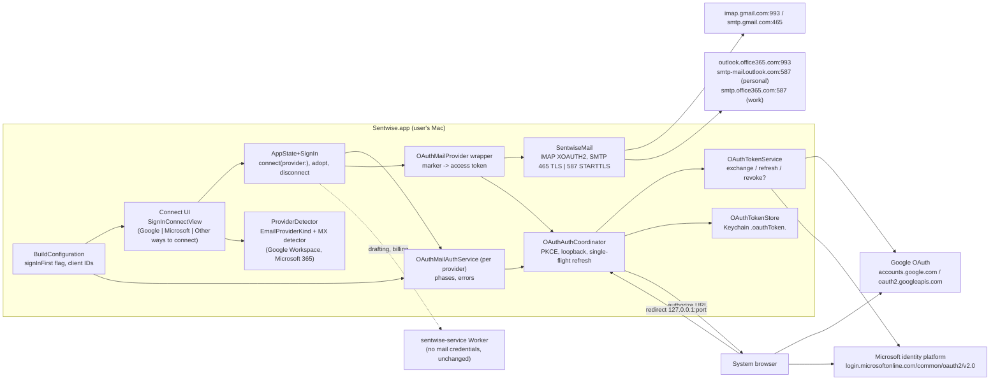

# Sign-in first: architecture

Slug: `sign-in-first`. Branch: `req/sign-in-first`. Brief: `docs/requirements/sign-in-first.md` (stories US-sign-in-first-1 to 10, questions A1-A9). Backlog: 135 (hide the app password), 134 (Google published + CASA, gate), 31 (Microsoft sign-in), 136 (Entra registration and publisher verification). Owner decision 2026-10-28: Google only at launch; app password moves behind "Other ways to connect" after Google publishing and CASA; Microsoft over IMAP/SMTP XOAUTH2 is the second provider, in the release after launch.

Status: design by solution-architect, 2026-10-28. The ui-designer's `## UX review` (in the brief) owns layout and copy; this document fixes behaviour, states, contracts and copy constraints.

## 1. Context

What exists (item 104, shipped):
- Google sign-in: bundled "Desktop app" client from build settings (`Sentwise/Config/GoogleOAuth.xcconfig`, empty in the repo, filled by release secrets) -> Info.plist `SentwiseGoogleOAuthClientID` / `...Secret` -> `GoogleOAuthClientConfiguration.bundled()`.
- Flow: `GmailAuthCoordinator` runs authorization code + PKCE (S256) with a loopback redirect `http://127.0.0.1:<random port>` (`LoopbackRedirectListener`, 300 s timeout), exchanges and refreshes through `OAuthTokenService`, keeps a single-flight refresh per mailbox (token generations), and revokes on disconnect. Tokens: Keychain `gmail.oauthToken.<email>` via `GmailAuthStore` (JSON `OAuthToken`, this-device-only).
- Mail transport: `GoogleOAuthMailProvider` wraps `MailProvider`; the account's credential slot (`mail.appPassword.<email>`) holds the marker `sentwise-google-oauth:v1`, and the wrapper swaps it for a fresh access token before each IMAP or SMTP session. `SentwiseMail` speaks `AUTHENTICATE XOAUTH2` (SASL-IR) for IMAP and XOAUTH2 for SMTP.
- UI: `GoogleOrAppPasswordConnect` (`Views/GoogleSignInConnectView.swift`) shows the Google button, then a `DisclosureGroup` "Use an app password instead" / "Connect with an app password" wrapping `appPasswordForm()` (email, app password, Test Connection, guidance, "Advanced (IMAP server)"). `MailConnectMethod.recommended(email:host:isGoogleSignInAvailable:)` picks Google or app password; `GoogleWorkspaceMXDetector` detects Workspace domains by MX (1.5 s timeout, cached). `AppState.isGoogleSignInAvailable` is `googleMailAuth.isAvailable && !ProwlHuntRuntime.current.isEnabled`.
- Provider table: `EmailProviderKind` (gmail, att, yahoo, aol, icloud) drives host suggestion and credential guidance. `MailboxNaming.forHost` picks static folder names (gmail, yahoo, icloud, generic); there is no SPECIAL-USE discovery yet.
- SMTP: `SMTPSend.swift` connects with implicit TLS only (default port 465). There is no STARTTLS.
- Saved accounts: `SavedMailAccount` stores `email`, `host`, `port`; SMTP host is derived (`imap.` -> `smtp.`), SMTP port 465 (`MailAccountCredentials`). Settings schema: saved accounts version 11.
- Tiers: connected accounts 2 / 1 / 2 / up to 5 (`docs/tier-matrix.md`); no change.

What changes:
- Part A (135): the app-password form is hidden behind "Other ways to connect" when a build flag is on and Google sign-in is available; the email field moves outside the disclosure so the screen can detect the provider and pass a login hint.
- Part C (31): a second OAuth provider, Microsoft, on the same rails: a provider-neutral OAuth layer, a Microsoft client configuration, STARTTLS for SMTP submission on 587, per-account SMTP endpoint persistence, Microsoft folder naming plus SPECIAL-USE discovery, an SMTP AUTH probe at connect, and Microsoft-specific error mapping.

What stays: the IMAP engine, app-password storage and validation, host suggestion and guidance, the Google flow's behaviour, the managed proxy (it never sees mail credentials), tiers and billing.

## 2. Components and boundaries



Boundaries:
- Only `OAuthTokenService` talks to identity endpoints; only `SentwiseMail` talks to mail servers. The Worker is never in the mail path.
- Provider differences live in one value type, `OAuthProviderConfiguration` (section 4.1). The coordinator, store, wrapper and UI states are shared.
- The flag and the client IDs are read once from `BuildConfiguration`; no UI code reads Info.plist directly.

## 3. Data model and migrations

### 3.1 Keychain
| Item | Account key | Contents | Notes |
|---|---|---|---|
| Google tokens (exists) | `gmail.oauthToken.<email>` | JSON `OAuthToken` | Unchanged name; do not migrate. |
| Microsoft tokens (new) | `microsoft.oauthToken.<email>` | JSON `OAuthToken` + `tenantID` | `kSecAttrAccessibleAfterFirstUnlockThisDeviceOnly`, same as Google. |
| Credential slot (exists) | `mail.appPassword.<email>` | app password, or a marker | Markers: `sentwise-google-oauth:v1` (exists), `sentwise-microsoft-oauth:v1` (new). |

`OAuthTokenStore` is `GmailAuthStore` generalized with a key prefix per provider (`gmail`, `microsoft`). The Google prefix stays `gmail` so existing tokens keep loading.

`OAuthToken` gains an optional `tenantID: String?` (decoded with `decodeIfPresent`; Google tokens leave it nil). No other change.

### 3.2 Saved accounts (Settings, schema 11 -> 12 for saved accounts)
`SavedMailAccount` gains optional fields:
- `smtpHost: String?`, `smtpPort: Int?`, `smtpSecurity: String?` (`"tls"` | `"starttls"`), `authProvider: String?` (`"google"` | `"microsoft"` | nil for app password).

Rules: nil means "derive as today" (`imap.` -> `smtp.`, 465, TLS), so every existing account reads unchanged. Microsoft accounts always write all four. Rollback: `SavedMailAccount` uses synthesized `Codable`, so older builds ignore the unknown keys and new optional fields decode as nil and a Microsoft account opened in an older build fails SMTP with an auth error, which is acceptable because Microsoft never ships in a build that cannot read it; the schema bump is additive and needs no down-migration. Test: decode a version-11 fixture into the version-12 model and back.

`authProvider` replaces sniffing the credential marker in UI code (`activeAccountUsesGoogleSignIn`); the marker stays as the transport switch, the field is set on adoption and back-filled at launch for accounts whose slot holds the Google marker.

### 3.3 No server data
Nothing is added to the Worker, Clerk, Paddle or D1. No migration outside the app.

## 4. APIs and contracts

### 4.1 OAuthProviderConfiguration (app-internal)
```
struct OAuthProviderConfiguration {
  id: OAuthProviderID            // .google, .microsoft
  clientID: String
  clientSecret: String?          // Google desktop client: present; Microsoft: nil, never sent
  authorizationEndpoint: URL
  tokenEndpoint: URL
  revocationEndpoint: URL?       // Google: oauth2.googleapis.com/revoke; Microsoft: nil
  scopes: [String]
  requiredGrantedScopes: [String]
  extraAuthorizationParameters: [String: String]
  keychainPrefix: String         // "gmail" | "microsoft"
  credentialMarker: String
  emailFromIDToken: (claims) -> String?
}
```
`GoogleOAuthClientConfiguration.bundled()` becomes `OAuthProviderConfiguration.google(bundle:)`; add `.microsoft(bundle:)`. Each returns nil when its client ID is empty, which makes that provider unavailable.

### 4.2 Microsoft identity endpoints (A1, A2)
- Authorize: `GET https://login.microsoftonline.com/common/oauth2/v2.0/authorize`
  `client_id, response_type=code, redirect_uri=http://localhost:<port>, response_mode=query, scope=<below>, state, code_challenge, code_challenge_method=S256, prompt=select_account, login_hint=<typed address if any>`, plus `domain_hint=consumers` when the typed domain is a personal Microsoft domain.
- Token: `POST https://login.microsoftonline.com/common/oauth2/v2.0/token` form body
  - code: `client_id, grant_type=authorization_code, code, redirect_uri, code_verifier, scope`
  - refresh: `client_id, grant_type=refresh_token, refresh_token, scope`
  - No `client_secret` ever (public client; sending one returns AADSTS700025).
- Scopes (one request, one token): `https://outlook.office.com/IMAP.AccessAsUser.All https://outlook.office.com/SMTP.Send offline_access openid email`. IMAP and SMTP scopes share the `outlook.office.com` resource, so one access token authenticates both. `openid email` give the ID token for the address; `offline_access` gives the refresh token. No Graph scopes.
- Required granted scopes: both `outlook.office.com` scopes; a token response missing either -> `missingRequiredScopes`.
- Response used: `access_token`, `refresh_token`, `expires_in`, `scope`, `id_token`. ID-token claims read (no signature check, the token came over TLS from the token endpoint, same as Google): `email`, then `preferred_username`, and `tid`.
- Revocation: no endpoint. Disconnect deletes local tokens and shows a link to remove the app's access: personal `https://account.live.com/consent/Manage`, work `https://myapps.microsoft.com`.

### 4.3 Loopback redirect
Microsoft accepts `http://localhost` registered on the "Mobile and desktop applications" platform with any port at runtime. The app keeps `LoopbackRedirectListener` (bound to loopback) and sends `redirect_uri=http://localhost:<port>` for Microsoft (Google keeps `http://127.0.0.1:<port>`). The redirect URI string is a per-provider configuration field (`redirectHost`). Risk and verification in section 10 (R2).

### 4.4 Mail endpoints (A6)
| Account | IMAP | SMTP | Detected by |
|---|---|---|---|
| Personal (Outlook.com, Hotmail, Live, MSN) | `outlook.office365.com:993` TLS | `smtp-mail.outlook.com:587` STARTTLS | `tid == 9188040d-6c67-4c5b-b112-36a304b66dad` |
| Work or school (M365 commercial) | `outlook.office365.com:993` TLS | `smtp.office365.com:587` STARTTLS | any other `tid` |

SASL username for XOAUTH2 is the signed-in address from the ID token, never the typed one.

### 4.5 SentwiseMail changes
- `SMTPSecurity` enum: `.implicitTLS` (default, today) and `.startTLS`. `.startTLS` = plain TCP, read 220, `EHLO`, `STARTTLS`, read 220, add the NIOSSL handler to the pipeline, `EHLO` again, then the existing AUTH path. Refuse to authenticate if the server does not advertise STARTTLS (no plaintext fallback).
- `MailAccountCredentials` gains `smtpSecurity` (default `.implicitTLS`).
- `SMTPSend.probeAuthentication(credentials:)`: connect, (STARTTLS), AUTH XOAUTH2, `QUIT`. Sends no mail. Used at connect for Microsoft.
- `MailboxNaming.microsoft`: sent `Sent Items`, drafts `Drafts`, junk `Junk Email`, trash `Deleted Items`, archive `Archive`, allMail nil. Plus `MailboxNaming.discover(from LIST)`: run `LIST "" "*" RETURN (SPECIAL-USE)` (or plain LIST and read attributes) and override sent / drafts / junk / trash / archive with `\Sent`, `\Drafts`, `\Junk`, `\Trash`, `\Archive` when present. Discovery runs for Microsoft accounts at connect and is cached per account; static names are the fallback. Other providers keep static names (no behaviour change for shipped providers).
- `IMAPAppend` (Drafts) already takes `MailAuthentication`, so XOAUTH2 append needs no change beyond the wrapper.
- Sent copies: Sentwise does not APPEND sent mail; Exchange Online and Outlook.com save SMTP-submitted mail to Sent Items server-side. Verified in the live test (section 8), and if false, the builder adds an APPEND to the discovered Sent folder for Microsoft accounts only.

### 4.6 Errors (app-internal `OAuthError`, extended)
| Source | Mapped to | User sees | Retry |
|---|---|---|---|
| `error=access_denied` / AADSTS65004 on redirect | `.authorizationDenied` | "Microsoft sign-in was cancelled." + Try again | user |
| Redirect timeout 300 s / browser closed | `.redirectTimedOut` | same as cancelled | user |
| `state` mismatch | `.stateMismatch` | "Sign-in could not be verified. Try again." | user; nothing stored |
| AADSTS65001, AADSTS90094, AADSTS90095, `consent_required` | `.adminConsentRequired(tenantID)` (new) | "Your organization requires an administrator to approve Sentwise." + "Copy a note for your IT admin" | none |
| `invalid_grant`, `interaction_required`, AADSTS50173, 70000, 70008, 50076, 50079, 53003, 50158 on refresh | `.reauthenticationRequired` (new; Google `invalid_grant` maps here too) | "Sign in with Microsoft again" banner, once | none until user acts |
| `temporarily_unavailable`, HTTP 429/5xx, network | `.temporarilyUnavailable` | "Microsoft is not responding. Sentwise will try again." | backoff 30 s, 2 min, 10 min, then on next sync |
| Scope missing in token | `.missingRequiredScopes` | "Sign-in did not grant mail access. Try again and allow all permissions." | user |
| IMAP `AUTHENTICATE` NO with a token minted < 60 s ago | `.mailboxProtocolDisabled(.imap)` (new) | "IMAP access is off for this mailbox." + admin note | none |
| SMTP 535 5.7.139 / 5.7.3 "SmtpClientAuthentication is disabled" | `.mailboxProtocolDisabled(.smtp)` | "Sending (SMTP AUTH) is off for this mailbox." + admin note | none |

Logging: the AADSTS code, `error`, `tid` (not the address) and HTTP status are logged with the existing privacy-safe logger; never the code, tokens, or ID token. Raw codes never reach the UI except inside the copied admin note.

The admin note (plain text, copied to the clipboard): app name "Sentwise", the Entra application (client) ID, the permissions requested (IMAP.AccessAsUser.All, SMTP.Send, offline_access, openid, email), the admin-consent URL `https://login.microsoftonline.com/<tid>/adminconsent?client_id=<id>`, and for protocol errors the PowerShell lines to enable IMAP or SMTP AUTH for one mailbox (`Set-CASMailbox -Identity <address> -ImapEnabled $true`, `Set-CASMailbox -Identity <address> -SmtpClientAuthenticationDisabled $false`). The address is the user's own; it is only placed in the clipboard.

### 4.7 Build configuration and flags
| Key | Build setting | Info.plist key | `BuildConfiguration` | Default in repo |
|---|---|---|---|---|
| Hide app password | `SENTWISE_SIGN_IN_FIRST` (`YES`/empty), new `Sentwise/Config/SignInFirst.xcconfig` included like `GoogleOAuth.xcconfig`; `QA.xcconfig` sets `YES` | `SentwiseSignInFirst` | `signInFirst: Bool` | empty (off) |
| Microsoft client | `SENTWISE_MICROSOFT_CLIENT_ID` in new `Sentwise/Config/MicrosoftOAuth.xcconfig` (gitignored values, like Google) | `SentwiseMicrosoftOAuthClientID` | via `OAuthProviderConfiguration.microsoft` | empty (Microsoft unavailable) |

Release: `release.sh` / `release.yml` pass `SENTWISE_MICROSOFT_CLIENT_ID` from a repository secret (it is not secret, but treated like the Google ID for one pattern) and `SENTWISE_SIGN_IN_FIRST` from a repository variable. The variable is set to `YES` only by the owner after item 134 is done (US-4). The QA configuration used on Lucius' Mini sets both. No runtime remote kill switch is added; the existing `isGoogleSignInAvailable` false paths remain the fallback.

## 5. Auth, billing, privacy and consent

### 5.1 Part A states (item 135)
Let `hide = signInFirst && isGoogleSignInAvailable`.
- `hide == false` (flag off, no Google client, Prowl hunt mode without the fake, or any other reason Google is unavailable): today's UI, unchanged. This is the fallback when Google sign-in is unavailable: the app-password form shows directly, never hidden behind a disclosure, because hiding it would leave no way to connect.
- `hide == true`, new connection: email field (outside any disclosure), "Continue with Google", and a collapsed "Other ways to connect" disclosure containing app password, Test Connection, guidance and "Advanced (IMAP server)". The email field is shared: typing in it feeds detection and the Google `login_hint`; the expanded form reuses the same value (one field, not two).
- Hints from detection (no auto-expand): Gmail or Workspace MX -> nothing extra; Yahoo / AOL / AT&T / iCloud / unknown custom domain -> inline hint "Use Other ways to connect for <Provider>"; Microsoft domain or Microsoft 365 MX before Microsoft ships -> inline note (A9).
- `hide == true`, editing an existing app-password account in Settings: the disclosure is expanded for that account (`authProvider == nil` and a stored password). Disconnecting the last app-password account returns to the collapsed default.
- Google failure: error message with "Try again"; the disclosure keeps its state (collapsed unless the user opened it).

### 5.2 Microsoft consent and copy constraints (item 31)
- Shown before the browser opens, under "Sign in with Microsoft": what is requested (read, draft and send mail on your behalf), that mail and sign-in tokens stay on this Mac in the Keychain and are never sent to Sentwise servers, and for work addresses that "Your IT administrator may need to approve Sentwise." Final words come from the ui-designer and are owner-approved.
- Must not say: "Outlook supported" anywhere before the release that ships item 31; "We never read your mail" (Sentwise reads it, locally); any Prowl reference; any promise that admin approval is not needed.
- Microsoft's consent screen shows the publisher name and "verified" badge only after publisher verification (item 136). Without it, users in many tenants cannot consent at all (Microsoft blocks user consent to unverified multi-tenant apps by default since 2020 for new tenants and in tenants with the "verified publishers only" policy). That is why 136 gates the public flag for work accounts.

### 5.3 Privacy
Leaves the device: the authorization request through the system browser and the token calls to `login.microsoftonline.com`; IMAP/SMTP traffic to Microsoft. Nothing new reaches the Worker. Stored: tokens in the Keychain this-device-only; `tid` in the token blob and the logs (tenant ID is an organization identifier, not personal data, but it is not sent anywhere). The sentwise.ai privacy policy must add a Microsoft section (data accessed, local storage, revocation link) before the Microsoft flag is on in a public build (US-10; landing-page item to be filed by the BA).

### 5.4 Billing
None. Microsoft accounts count toward the existing connected-accounts limit (`docs/tier-matrix.md`), enforced where it is enforced today.

### 5.5 A8: review programs
There is no CASA-equivalent security assessment for Microsoft IMAP/SMTP delegated scopes. Required: Entra app registration, a verified publisher domain (sentwise.ai, via a JSON file at `https://sentwise.ai/.well-known/microsoft-identity-association.json`, a landing-page change), and publisher verification, which needs a Microsoft AI Cloud Partner Program (formerly MPN) ID for Genkei Labs LLC (free; the partner account's email domain must match the publisher domain). Microsoft 365 App Certification is optional and not planned.

## 6. Main sequences

### 6.1 Happy path: Microsoft personal account
1. User types `name@outlook.com` (or nothing) and chooses "Sign in with Microsoft".
2. `OAuthAuthCoordinator.authorize(.microsoft, loginHint:)` starts the listener on `127.0.0.1:<random>`, builds PKCE and `state`, opens the system browser at the authorize URL.
3. User signs in and consents; Microsoft redirects to `http://localhost:<port>/?code&state`; the listener returns the parameters, the page says "You can close this tab".
4. State checked; code exchanged at the token endpoint (no secret); scopes checked; address and `tid` read from the ID token.
5. Tokens saved to `microsoft.oauthToken.<address>`; account built: IMAP `outlook.office365.com:993`, SMTP by `tid`, `.startTLS`, marker in the credential slot, `authProvider = "microsoft"`.
6. Verification: IMAP connect + XOAUTH2 + `LIST` (SPECIAL-USE discovery) + `SELECT INBOX`; SMTP probe (AUTH only). Both pass -> account adopted, "Connected as <address> with Microsoft".
7. Later: before each session the wrapper asks the coordinator for a valid token; within 5 minutes of expiry it refreshes (single flight), saves the new refresh token (Microsoft rotates it), and continues.

### 6.2 Failure: admin consent required (work account)
Steps 1-3; Microsoft redirects with `error=access_denied` / `consent_required` and an AADSTS65001 or 90094 description (or shows the "Need admin approval" page and the user closes it -> timeout). Coordinator maps to `.adminConsentRequired`; UI shows the admin message and "Copy a note for your IT admin"; nothing is stored; logged: error, AADSTS code, `tid` if present. No retry.

### 6.3 Failure: SMTP AUTH or IMAP disabled for the mailbox
Steps 1-5 succeed; step 6 IMAP fails with NO on AUTHENTICATE (fresh token) or the SMTP probe returns 5.7.139. Result: tokens deleted, account not adopted, message names the protocol and offers the admin note. Logged: protocol, SMTP reply code. No retry. (Without the probe this would surface only at the first send, after the user has written drafts; that is why the probe exists.)

### 6.4 Failure: refresh rejected later
A background sync refresh returns `invalid_grant` / `interaction_required` (password change, conditional access, 90 days unused, user removed consent). Coordinator marks the account `needsReauthentication`, stops refreshing for that account, and the UI shows one banner "Sign in with Microsoft again" (and in Settings). Drafts already generated stay. A send attempted in this state fails before any SMTP traffic, keeps the draft, and shows the same banner; nothing is sent twice because the send never started. Sign-in again replaces tokens for the same address; a different address is rejected with "Signed in as <other>; sign in with <expected>".

### 6.5 Failure: send interrupted mid-session
Token expires or the connection drops after DATA has started: existing SMTP behaviour applies (draft kept, error shown). After a failure after the final `.` and before the 250 reply the state is ambiguous; the existing send path already treats it as failed. The builder confirms the existing send path does not auto-retry (US-9 AC "nothing is sent twice").

## 7. Non-functional requirements
- Timeouts: redirect 300 s (existing); token calls 20 s; MX lookup 1.5 s (existing, extended to Microsoft records); SMTP probe 15 s.
- Refresh margin 5 minutes; one refresh in flight per account; backoff on transient errors 30 s / 2 min / 10 min.
- Offline: no refresh attempt while offline; the cached access token is used if valid; otherwise sync waits; no "sign in again" for network errors.
- Rate limits: Microsoft throttles token requests per user and app; single flight and caching keep the app far below them. IMAP connection limits on Exchange Online (about 20 concurrent per mailbox) are well above Sentwise's usage; no change.
- Performance: connect-time verification (IMAP + probe) under 5 s on a normal network; detection never blocks typing (debounced as today).
- Observability: log events `oauth.authorize.start|success|error`, `oauth.refresh.success|error`, `oauth.reauth_required`, `mail.protocol_disabled`, each with provider, error code and `tid`, never the address, tokens or code.
- Accessibility: the disclosure and both sign-in buttons are keyboard operable with labels and expanded state; VoiceOver announces the inline hints.

## 8. Test strategy hooks
Unit (CI and Lucius' Mini; never the MacBook):
- `OAuthProviderConfiguration`: Google values identical to today (regression); Microsoft has no secret, `redirectHost == localhost`, scopes and required scopes as section 4.2.
- `OAuthTokenService` against a stubbed URLSession: Microsoft exchange without `client_secret`; refresh rotates the refresh token and persists the new one; every row of the error table maps as specified; revoke is a no-op for Microsoft.
- Coordinator: single flight under two concurrent callers (port of the Google superseded-refresh tests); `needsReauthentication` stops further refreshes.
- `SentwiseMail`: STARTTLS state machine with a scripted server (220, EHLO, STARTTLS, re-EHLO, AUTH XOAUTH2 334 challenge, 235); refuses AUTH when STARTTLS is not advertised; probe sends no MAIL FROM; SPECIAL-USE parsing including localized names (for example `Elementos enviados` with `\Sent`).
- Detection: `EmailProviderKind.microsoft` for outlook.com, hotmail.com, live.com, msn.com and regional variants (hotmail.co.uk, outlook.de, live.fr ...); MX `*.mail.protection.outlook.com` -> Microsoft 365.
- Settings decode: schema 11 fixture loads in 12 with nil SMTP fields; Microsoft account round-trips.
- Part A view states (ViewInspector or snapshot): flag off; flag on + Google available; flag on + Google unavailable (form shown directly); existing app-password account (expanded); A9 note for `@outlook.com`.
Live (Lucius' Mini, dispatch workflow, like `GmailOAuthLiveTests`): `MicrosoftOAuthLiveTests` with secrets `SENTWISE_LIVE_MICROSOFT_OAUTH_REFRESH_TOKEN_PERSONAL`, `..._WORK` and test addresses on `example.com`-style test tenants: refresh, IMAP LIST/SELECT, SMTP probe, send one message to itself and confirm it appears in Sent Items. Seed data: one Outlook.com test account and one M365 developer-tenant mailbox owned by Genkei Labs; one M365 mailbox with SMTP AUTH disabled for the 6.3 case.
Device/UAT (Lucius): the browser consent round trip for personal and work accounts; admin-consent message on a tenant with user consent disabled; Part A screens in light/dark and with VoiceOver.
Planner TC cases must cover each AC in the brief plus sections 6.2 to 6.4.

## 9. Trade-offs considered
- Microsoft Graph REST mail instead of IMAP/SMTP: rejected. It needs a second mail engine (fetch, folders, send) alongside `SentwiseMail`, and the brief's non-goals exclude it. IMAP XOAUTH2 covers read, draft (APPEND) and send. Kept as the fallback only if the live test shows SMTP AUTH is unusable for most work tenants; then `Mail.Send` via Graph for sending only would be the smallest change.
- MSAL for macOS: rejected. It adds a dependency and a broker/keychain-group model for a flow the existing coordinator already does; plain v2.0 endpoints with PKCE are supported for public clients.
- Authority `consumers` + `organizations` as two registrations: rejected; one multi-tenant registration with `common` serves both and keeps one client ID.
- Custom URL scheme redirect: rejected; loopback is already built, matches Google, and avoids scheme hijacking concerns.
- Hiding the app password with a runtime remote flag (Worker): rejected; a build flag needs no new server surface, and the release is already the owner-approved step.
- Two email fields (one for sign-in, one in the form): rejected; one shared field.
- Delete the app-password path: rejected by the decision (non-Google providers need it).

## 10. Risks and open questions

Risks
- R1. Work tenants block user consent or SMTP AUTH (Microsoft disables SMTP AUTH by default in newer tenants and is retiring Basic auth for SMTP; OAuth SMTP AUTH remains supported but must be enabled per tenant or mailbox). Mitigation: probe at connect, admin note, honest copy. Assumption: personal accounts carry the release if work accounts are mostly blocked.
- R2. Redirect URI: the design assumes `http://localhost` on the desktop platform accepts any port. If Entra requires the exact port or rejects `localhost` for multi-tenant + personal, register `http://127.0.0.1` via the manifest. Verify during item 136 before the builder starts the flow story.
- R3. Sent copies: assumed saved server-side on SMTP submit; verified live (section 4.5).
- R4. Publisher verification needs the partner program enrolment and a domain match; if delayed, personal accounts still work (user consent for personal accounts does not need verification, though the consent screen shows "unverified").
- R5. Microsoft refresh-token rotation: failing to persist the new refresh token silently breaks the account after the old one expires. Covered by a unit test.

Answers to A1-A9 (brief section 8)
- A1. One multi-tenant registration, supported account types "Accounts in any organizational directory and personal Microsoft accounts" (`signInAudience: AzureADandPersonalMicrosoftAccount`), authority `common`; public client ("Allow public client flows" on), platform "Mobile and desktop applications", redirect `http://localhost` (R2); PKCE S256; no client secret, ever. Publisher domain sentwise.ai and publisher verification with the Genkei Labs LLC partner ID (item 136).
- A2. Minimal scopes: `https://outlook.office.com/IMAP.AccessAsUser.All`, `https://outlook.office.com/SMTP.Send`, `offline_access`, `openid`, `email`. Same resource, so one token for IMAP and SMTP. Graph `Mail.Send` only as the fallback in section 9.
- A3. Refresh tokens: 90 days, sliding, rotated on each use (persist the new one); revoked by password change, consent removal, admin action, conditional-access failure. Error codes mapped in section 4.6 to `.reauthenticationRequired`. Reuse the Google single-flight refresh, generalized.
- A4. In scope: personal (Outlook.com, Hotmail, Live, MSN) and Microsoft 365 commercial work or school mailboxes. Out: shared and delegated mailboxes, GCC / GCC High / DoD / China and other sovereign clouds, on-prem Exchange, Exchange hybrid on-prem mailboxes. Out-of-scope accounts get the generic sign-in failure plus "This kind of Microsoft account is not supported yet."
- A5. Admin consent: detected from AADSTS65001 / 90094 / 90095 at authorization. IMAP: enabled per mailbox by default in Exchange Online but admins can turn it off (`ImapEnabled`); SMTP AUTH: per tenant and per mailbox (`SmtpClientAuthenticationDisabled`), often off. Detected at connect by the IMAP login and the SMTP probe; message and admin note in 4.6.
- A6. IMAP `outlook.office365.com:993`; SMTP `smtp-mail.outlook.com:587` (personal) or `smtp.office365.com:587` (work), STARTTLS, a new `SentwiseMail` capability (section 4.5). Folders: `MailboxNaming.microsoft` plus SPECIAL-USE discovery for localized names.
- A7. Provider-neutral layer: `OAuthProviderConfiguration`, `OAuthAuthCoordinator`, `OAuthTokenService`, `OAuthTokenStore`, `OAuthMailProvider`; `MailConnectMethod` gains `.microsoftSignIn`; `EmailProviderKind` gains `.microsoft`; MX detector generalized. Keychain naming `<prefix>.oauthToken.<email>`, Google prefix kept as `gmail`. Multi-account: each account carries its own `authProvider`; any mix is allowed within the tier limit. The rename lands first as a refactor story with Google tests unchanged and green.
- A8. No CASA-like assessment. Publisher verification (partner program ID, verified domain) and optional App Certification (not planned).
- A9. The hide flag is build-time and defaults off; older builds are unaffected; existing app-password accounts are untouched and their Settings form is expanded. Until Microsoft ships, typing a Microsoft domain (or a Microsoft 365 MX domain) shows an inline note: "Microsoft no longer allows app passwords for Outlook.com and Hotmail. Sign in with Microsoft is coming in a future update." (final copy from the ui-designer). Reason: Microsoft removed Basic authentication for IMAP/SMTP in personal accounts and Exchange Online, so a password, including an app password, is rejected; only OAuth works. The disclosure stays usable (a work tenant with an on-prem or third-party IMAP host is still a custom host).

Questions only the owner can answer (assumption in brackets)
1. Entra tenant and partner program: may vendor-ops create a Genkei Labs LLC Entra tenant and Microsoft AI Cloud Partner Program enrolment under a sentwise.ai or genkeilabs address? [Assumed yes, owner signs in and accepts terms; vendor-ops prepares the steps.]
2. May Microsoft ship personal-accounts-first (work accounts behind the same build but with copy that admin approval may be needed) if publisher verification is still pending at the release after launch? [Assumed yes.]
3. Test mailboxes: approve one Outlook.com account and one Microsoft 365 developer-program tenant (free, renewable) owned by Genkei Labs for live tests. [Assumed yes; no cost.]

## 11. Story-to-design map and technical tasks

| Story | Design sections | Technical tasks (backlog item) |
|---|---|---|
| US-1 | 4.7, 5.1 | T135-1 flag plumbing `SENTWISE_SIGN_IN_FIRST` -> `SentwiseSignInFirst` -> `BuildConfiguration.signInFirst`, off in repo, on in QA config. T135-2 move the email field out of `appPasswordForm()` into the shared connect view; Google uses it as `login_hint`. T135-3 `hide` state in `GoogleOrAppPasswordConnect` (onboarding and Settings), disclosure label "Other ways to connect", accessibility identifiers kept (`signInWithGoogle`, `appPasswordFallback`) plus `otherWaysToConnect`. T135-4 onboarding subtitle by state (copy from UX review). |
| US-2 | 5.1 | T135-5 inline provider hint from `EmailProviderKind` / MX detection (no auto-expand). |
| US-3 | 3.2, 5.1 | T135-6 `authProvider` field and launch back-fill; Settings expands the disclosure for app-password accounts. |
| US-4 | 4.7 | T135-7 release wiring: repository variable `SENTWISE_SIGN_IN_FIRST`, release checklist line "134 done before setting it". T135-8 view-state tests (section 8). |
| US-5 | gmail-oauth.md 4-5 | No new code; map Google `invalid_grant` to `.reauthenticationRequired` (T31-3 covers both providers). |
| US-6 | 4.1-4.4, 6.1 | T31-1 provider-neutral refactor (no behaviour change). T31-2 Microsoft configuration and `MicrosoftOAuth.xcconfig`, release secret pass-through. T31-4 detection (`EmailProviderKind.microsoft`, Microsoft 365 MX). T31-5 Microsoft connect UI and button. |
| US-7 | 4.6, 6.2, 6.3 | T31-3 error mapping and admin note. T31-7 SMTP probe and protocol-disabled errors. |
| US-8 | 4.6, 6.4 | T31-3; rotation persistence; `needsReauthentication` state and banner. |
| US-9 | 4.4, 4.5, 6.5 | T31-6 SMTP STARTTLS + `smtpSecurity`, saved-account schema 12. T31-8 `MailboxNaming.microsoft` + SPECIAL-USE discovery. T31-9 live tests on Lucius (send, Sent Items, Drafts APPEND). |
| US-10 | 5.2, 5.3 | T31-10 consent copy block (UX review, owner-approved); landing-page privacy section (BA files the item). |
| (136) | 5.5, A1, R2 | T136-1 Entra registration per A1; T136-2 publisher domain file on sentwise.ai; T136-3 partner program ID and publisher verification; T136-4 record client ID (not secret) as repository secret `SENTWISE_MICROSOFT_CLIENT_ID`; T136-5 confirm redirect behaviour (R2) and report. |

Build order: T31-1 first (refactor, Google green), then T31-6 and T31-8 (transport, testable without Microsoft), then T31-2..5, 7, 9, 10. Part A (T135-*) is independent and can start now.

What a builder still cannot start without: T31-2 onward needs a client ID from item 136 for live runs (unit work can use a placeholder GUID); T31-9 needs the test mailboxes (owner question 3); T135 copy needs the ui-designer's UX review (behaviour can be built first).
