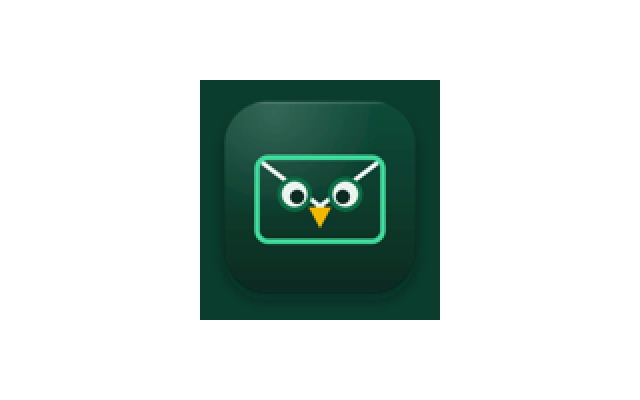
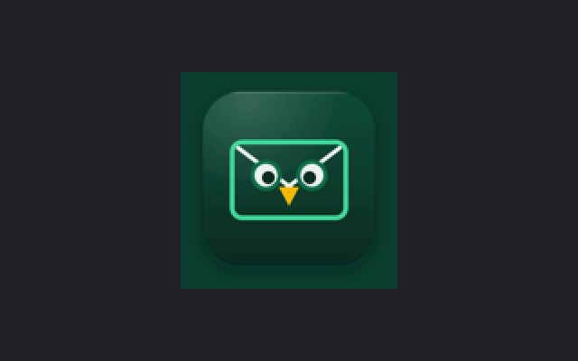

# Google consent-screen logo

## Goal and use

Give Google's OAuth consent screen one unmistakably Sentwise mark at the small size Google renders. This is a branding asset, not an app screen: it has no interaction, motion, loading, empty, offline, error, partial, or success state.

Upload `assets/google-consent-logo-120.png` in **Google Cloud Console > APIs & Services > OAuth consent screen > Branding > App logo**. Michael approves the file through the PR before vendor-ops uploads it. This branch does not upload or publish anything.

## Source and treatment

The export comes from `Distribution/assets/png/icon_1024.png`, the app-icon render of the editable master at `Distribution/assets/Sentwise.svg`. It therefore uses the same owl-in-an-envelope geometry and the same forest, emerald, cloud, and gold palette as the macOS app icon and landing page.

The transparent area around the app-icon plate is flattened onto the brand forest (`#0A3D2D`). The result is a fully opaque square with approximately 10% outer breathing room around the plate. The fixed forest field prevents white or black corner artifacts when Google changes the surrounding surface. The cloud eyes and creases, emerald envelope, and gold beak retain their contrast on both consent-screen themes; recognition does not depend on the outer edge of the square.

Editable recipe: `assets/render-google-consent-logo.swift`. Run it from any directory to rebuild the 120 px deliverable and all four previews from the repository's 1024 px app-icon export. It uses AppKit only and adds no dependency.

## Preview

Each 1x preview places the actual 120 × 120 file on a 320 × 200 surface. Each 2x preview is a 640 × 400 pixel-density check with the logo rendered at 240 × 240. The dark surface is Google's `#202124`.

| Surface | 1x | 2x |
| --- | --- | --- |
| White |  |  |
| `#202124` |  |  |

## Accessibility, hierarchy, and tokens

The eye reads the cloud-white owl eyes first, the emerald envelope second, and the gold beak last. There is no text to become illegible, no Google trademark, and no claim or promise in the image. Google's adjacent app name supplies the accessible identity; the preview alt text names the product and context for reviewers.

Tokens are inherited from the brand master: forest background `#0A3D2D`, emerald `#3FD99B`, cloud `#EAF4EE`, deep forest `#072A20`, and gold `#F2B705`. Spacing is proportional rather than screen-layout spacing: the app-icon plate keeps its master-art safe area, approximately 10% on each side. Type scale, focus order, keyboard path, VoiceOver controls, Dynamic Type, and reduced motion do not apply to this static, text-free vendor asset.

## Decision record

No experiment report was supplied. Three treatments were considered:

1. transparent app-icon export, rejected because Google's light and dark surfaces could expose alpha-edge artifacts;
2. a redrawn or simplified owl, rejected because 120 px is large enough for the existing app mark and a redraw could drift from the app and site;
3. the existing app-icon export flattened onto solid brand forest, selected because it preserves the shipped mark, controls every pixel on either theme, and remains reproducible from the checked-in master.

## Verification

Run on 2026-10-28 CT:

```text
$ sips -g pixelWidth -g pixelHeight -g hasAlpha docs/design/assets/google-consent-logo-120.png
  pixelWidth: 120
  pixelHeight: 120
  hasAlpha: no

$ stat -f %z docs/design/assets/google-consent-logo-120.png
9115
```

The PNG is square, opaque, and 9,115 bytes, below Google's 1 MB limit.
